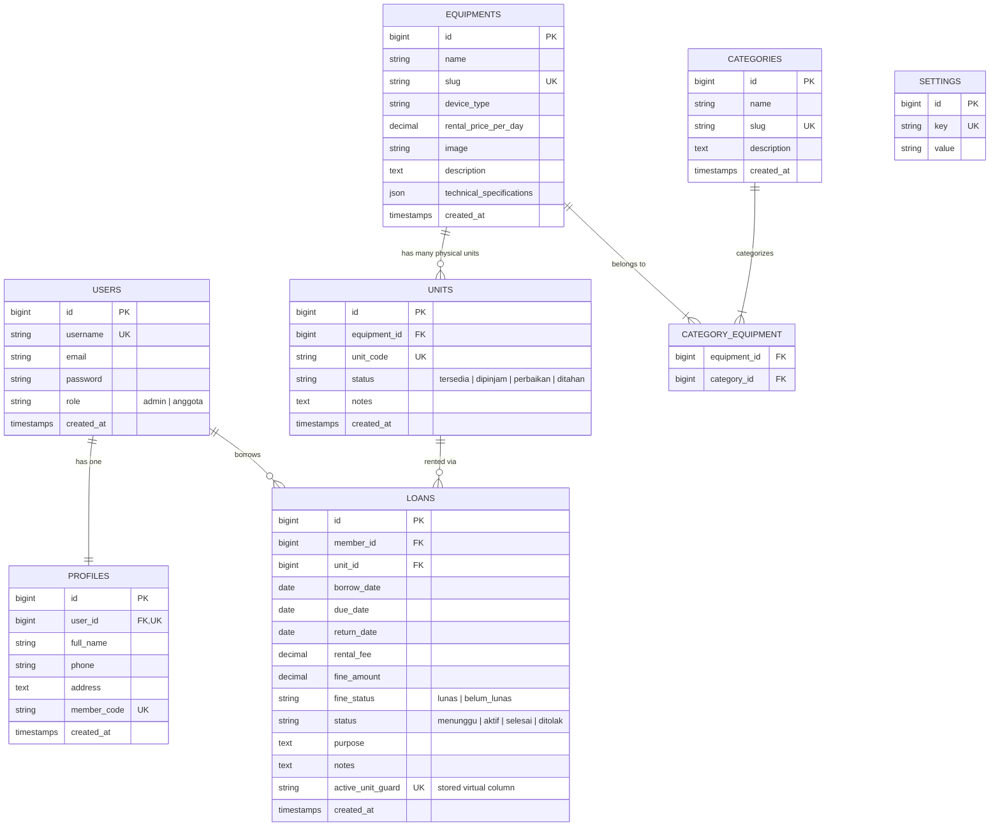

# GhostGear Rental 👻

> **Sistem Informasi Penyewaan Peralatan Investigasi Paranormal**  
> Dibuat untuk memenuhi tugas sertifikasi Web Development dengan arsitektur **Clean Architecture**, **Laravel 12**, **Livewire 3 (Volt)**, dan **Tailwind CSS (Custom Dark Aesthetic)**.

---

## 📋 Informasi Proyek & Tim

| Identitas | Keterangan |
|---|---|
| **Nama Kelompok** | **Kelompok Someah** |
| **Nama Team** | 1. **Hafizh Rizki Nugraha**<br>2. **Farid Munadhil**<br>3. **Tia Ivanka Taruk Langi** |
| **Nama Project** | **GhostGear Rental** |
| **Teknologi Utama** | Laravel 12 (PHP 8.4), Livewire 3 + Volt, Tailwind CSS, MySQL 8/9, Vite |
| **Gaya Desain** | Custom Cyber-Ghost Dark Aesthetic (`#00FF66` Neon Accent, No Default Templates) |

---

## 🗄️ Skema Project Database (ERD)

Berikut adalah diagram hubungan antar entitas (*Entity Relationship Diagram*) dalam basis data **GhostGear Rental**:



> **Catatan Integritas Data Basis Data**:
> - Relasi `User` ke `Profile` adalah *One-to-One* murni (`user_id` unik pada tabel `profiles`).
> - Relasi `Equipment` ke `Category` adalah *Many-to-Many* melalui tabel pivot `category_equipment` (1 jenis alat dapat memiliki banyak kategori).
> - Kode unit fisik (`unit_code`) memiliki constraint `UNIQUE` di basis data.
> - Kolom virtual `active_unit_guard` dengan indeks unik mencegah unit fisik yang sama dipinjam lebih dari 1 kali secara bersamaan pada tingkat mesin basis data MySQL.

---

## 🎥 Screen Recorder Demo Penjelasan Website

Tonton video demo rekaman layar penjelasan alur penggunaan website GhostGear Rental:

- **Link Video Demo**: [Tonton Demo Video di Sini (Google Drive / YouTube)](https://drive.google.com/file/d/your-video-link-here/view)
- **File Rekaman Lokal**: `docs/demo-ghostgear-rental.mp4`

*(Silakan sematkan link rekaman demo video presentasi kelompok pada bagian ini).*

---

## ⚡ List Fitur Aplikasi

Sistem GhostGear Rental dikembangkan untuk memenuhi seluruh kebutuhan fungsional dan aturan bisnis (*Business Rules*) tugas sertifikasi:

### 1. Autentikasi & Otorisasi
- **Login Menggunakan Username**: Autentikasi tunggal menggunakan `username` dan kata sandi.
- **Dua Jenis Hak Akses (Role)**:
  - **Admin**: Mengelola seluruh inventaris unit, kategori, data anggota, persetujuan peminjaman, pencatatan pengembalian, kalkulasi denda, dan cetak riwayat.
  - **Anggota (User)**: Menjelajahi katalog alat, mengajukan pinjaman unit fisik, memantau batas durasi pinjam 5 hari, melihat denda (jika ada), serta memperbarui data profil diri sendiri.
- **Proteksi Akses Penuh**: Seluruh rute selain login dilindungi middleware verifikasi sesi dan otorisasi peran (`role:admin` dan `role:anggota`). Pengguna tamu dialihkan otomatis ke halaman login.

### 2. Fitur Sisi Anggota (Investigator)
- **Katalog Unit & Pencarian**: Menampilkan daftar alat investigasi paranormal lengkap dengan gambar foto produk, tag kategori multiple, tarif sewa per hari, jumlah unit tersedia, dan pencarian instan (*live search*) berdasarkan nama dan kategori alat.
- **Detail Spesifikasi Alat**: Menampilkan foto alat berukuran besar, spesifikasi teknis lengkap (resolusi termal, sensitivitas EVP, jangkauan frekuensi EMF, daya tahan baterai, dsb.), status ketersediaan unit fisik, kalkulator durasi sewa & estimasi biaya sewa, serta formulir pengajuan sewa.
- **Aturan Batas Maksimal Pinjaman**: Anggota hanya dapat meminjam **maksimal 2 unit aktif** secara bersamaan. Jika kuota penuh, tombol pengajuan otomatis dinonaktifkan dengan peringatan visual.
- **Durasi Pinjam Maksimal 5 Hari**: Setiap pengajuan sewa dibatasi maksimal 5 hari kalender.
- **Pinjaman Saya**: Dashboard riwayat sewa anggota yang terbagi atas:
  - **Sedang Berjalan**: Menampilkan status *Menunggu Persetujuan* atau *Sedang Dipinjam*, tanggal jatuh tempo, sisa hari/keterlambatan, dan peringatan tarif denda.
  - **Selesai**: Menampilkan arsip pinjaman yang telah dikembalikan, status denda (Lunas/Nihil), dan rincian biaya.
- **Kelola Profil Pribadi**: Setiap user memiliki 1 profil yang dapat diubah secara mandiri (Nama Lengkap, Nomor Telepon/WhatsApp, Alamat Domisili, serta pembaruan Password).

### 3. Fitur Sisi Admin
- **Persetujuan & Pengembalian (Loans Approval & Return)**:
  - Menyetujui (*Approve*) atau Menolak (*Reject*) pengajuan sewa dari anggota.
  - Memproses pengembalian unit: memasukkan tanggal pengembalian riil, kondisi unit saat kembali, dan sistem otomatis menghitung denda keterlambatan jika melebihi batas 5 hari (Rp10.000.000 / hari keterlambatan).
  - Mengubah status denda menjadi Lunas saat anggota membayar.
- **Riwayat Peminjaman & Cetak Laporan (Print Preview)**:
  - Tabel riwayat komprehensif seluruh transaksi dengan filter pencarian dan filter status (Semua, Menunggu, Aktif, Selesai, Ditolak).
  - Fitur **Cetak Riwayat Peminjaman** khusus admin (`/admin/loans/print`) dengan format media cetak bersih (`@media print`), kop resmi GhostGear, ringkasan statistik, dan kolom tanda tangan pengesahan.
- **Manajemen Alat & Unit Fisik (CRUD)**:
  - Tambah, Ubah, dan Hapus jenis alat (`Equipment`) dengan upload gambar, tarif sewa per hari, dan spesifikasi teknis dinamis.
  - Tambah, Ubah, dan Hapus unit fisik (`Unit`) dengan kode unit unik (`unit_code`), kondisi, dan status ketersediaan.
  - Unit atau alat yang sedang memiliki pinjaman aktif diproteksi dari penghapusan.
- **Manajemen Kategori (CRUD)**:
  - Tambah, Ubah, dan Hapus kategori alat investigasi paranormal.
  - Hubungan multiple kategori ke setiap unit alat (*many-to-many*).
- **Manajemen Anggota / User (CRUD)**:
  - Tambah anggota baru, ubah informasi profil anggota, reset password, dan hapus akun anggota (anggota dengan pinjaman aktif diproteksi dari penghapusan).
- **Edit Profil Saya Admin**:
  - Halaman khusus admin untuk memperbarui profil, nomor telepon, dan password akun admin.

---

## 🏷️ Tarif Sewa Sesuai Mockup

Sesuai spesifikasi pada berkas mockup desain, tarif sewa per hari untuk setiap alat investigasi paranormal:

| Alat Investigasi | Kode Tipe | Tarif Sewa / Hari | Kategori Terkait |
|---|---|---|---|
| **Kamera Termal Flir E8-XT** | `flir-e8-xt` | **Rp 850.000** / hari | Visual, Infrared, Thermal |
| **Peralatan Night Vision PVS-14** | `night-vision-pvs14` | **Rp 600.000** / hari | Optik Gelap, Infrared, Visual |
| **EMF Meter TriField TF2** | `trifield-tf2` | **Rp 350.000** / hari | Deteksi Medan Magnet, Frekuensi |
| **Perekam Suara EVP Zoom H4n** | `evp-zoom-h4n` | **Rp 250.000** / hari | Audio, EVP Recorder, Frekuensi |
| **Sensor Gerak Ultrasonik PIR-X** | `sensor-pir-x` | **Rp 200.000** / hari | Sensor Gerak, Keamanan |

---

## 🎨 14 Halaman Desain Custom Sesuai Mockup

Seluruh tampilan dibuat custom dengan dark theme bertema investigasi paranormal modern tanpa template default Breeze / Filament, mencakup 14 layar utama:

1. `Landing page publik — GhostGear Rental.png` ➔ `/landing` (Public Landing Showcase)
2. `Login.png` ➔ `/login` (Autentikasi minimalis via Username)
3. `Katalog Unit.png` ➔ `/katalog` (Katalog alat + pencarian + ketersediaan)
4. `Detail Spesifikasi Alat.png` ➔ `/katalog/{id}` (Spesifikasi teknis & form sewa)
5. `Pinjaman Saya.png` ➔ `/pinjaman-saya` (Tabel berjalan & selesai)
6. `Profil Saya.png` ➔ `/profil-saya` (Tampilan kartu informasi anggota)
7. `Edit Profil Saya Anggota.png` ➔ `/profil-saya/edit` (Formulir ubah profil anggota)
8. `Edit Profil Saya Admin.png` ➔ `/admin/profil` (Formulir ubah profil admin)
9. `Persetujuan & Pengembalian.png` ➔ `/admin/persetujuan` (Approval & proses kembali)
10. `Kelola Anggota.png` ➔ `/admin/anggota` (Tabel & modal CRUD anggota)
11. `Kelola Kategori.png` ➔ `/admin/kategori` (Tabel & modal CRUD kategori)
12. `Kelola Alat & Unit.png` ➔ `/admin/alat-unit` (Tabel & modal CRUD alat dan unit)
13. `Riwayat Peminjaman.png` ➔ `/admin/riwayat` (Filter & riwayat transaksi sewa)
14. `Preview Cetak Riwayat Peminjaman.png` ➔ `/admin/loans/print` (Format cetak dokumen resmi)

---

## 🏛️ Penerapan Clean Architecture

Aplikasi ini dibangun menggunakan arsitektur bersih (*Clean Architecture*) 4 layer:

```
[Request HTTP / Form Livewire]
             │
             ▼
[Interface Layer]  ➔ Controller, Livewire Volt Components, View Blade
             │
             ▼
[Application Layer] ➔ LoanService, EquipmentCatalogService, FormRequests, Resources
             │
             ▼
[Domain Layer]      ➔ Entities (Loan, Equipment, Unit, User), Enums, Repository Interfaces
             │
             ▲
[Infrastructure]    ➔ Eloquent ORM Repositories, MySQL Database, Service Provider DI
```

---

## 👥 Akun Demo Bawaan (Hasil Seeder)

| Peran | Username | Password | Nama Akun | Hak Akses |
|---|---|---|---|---|
| **Admin** | `admin` | `ganti-saya` | Nadia Putri (ADM-001) | Akses Admin (`/admin/persetujuan`, dsb.) |
| **Anggota 1** | `investigator1` | `password123` | Dimas Pratama (AGT-001) | Akses Anggota (`/katalog`, `/pinjaman-saya`) |
| **Anggota 2** | `investigator2` | `password123` | Rian GhostHunter (AGT-002) | Akses Anggota (`/katalog`, `/pinjaman-saya`) |

---

## 🛠️ Panduan Instalasi & Menjalankan

### Prasyarat:
- PHP >= 8.3 (PHP 8.4 didukung penuh)
- Composer 2
- Node.js & NPM
- MySQL Server

### Langkah Instalasi:

1. **Clone repositori dan masuk ke folder:**
   ```bash
   cd Ghost-gear_rental
   ```

2. **Siapkan environment file `.env`:**
   ```bash
   cp .env.example .env
   ```
   Pastikan konfigurasi database di `.env`:
   ```env
   DB_CONNECTION=mysql
   DB_HOST=127.0.0.1
   DB_PORT=3306
   DB_DATABASE=ghostgear
   DB_USERNAME=root
   DB_PASSWORD=
   ```

3. **Install dependensi PHP & JavaScript:**
   ```bash
   composer install
   npm install
   ```

4. **Generate App Key:**
   ```bash
   php artisan key:generate
   ```

5. **Migrasi Database & Isi Data Mockup (Seeder):**
   ```bash
   php artisan migrate:fresh --seed
   ```

6. **Kompilasi Frontend Asset (Tailwind & Vite):**
   ```bash
   npm run build
   ```

7. **Jalankan Web Server:**
   ```bash
   php artisan serve
   ```
   Buka peramban di: `http://localhost:8000`

---

## 🧪 Pengujian Unit & Fitur (PHPUnit)

Seluruh 25 skenario pengujian bisnis GhostGear Rental dan Clean Architecture lulus **100%**:

```bash
php artisan test --compact
```

Hasil Pengujian:
```text
Pass: 25 | Assertions: 91 | Duration: 16.01s (100% PASS)
```
Semua aturan bisnis seperti batas maksimal 2 pinjaman aktif, durasi maksimal 5 hari, denda keterlambatan per hari, pencegahan unit ganda, proteksi hapus relasi aktif, serta autentikasi username telah teruji secara menyeluruh.
